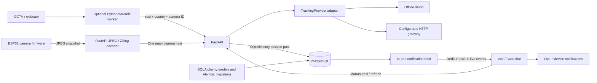

# Architecture

The initial flow is synchronous and local. The camera worker is a separately launched process in the backend app, so continuous capture does not block FastAPI's lifecycle or start multiple times with API workers.

## Current behavior

1. Normalize resi numbers to uppercase and courier codes to lowercase; validate the payload.
2. Find an existing shipment using the unique `(courier, resi_number)` pair.
3. For a new shipment, call the provider, then persist its result and the initial notification in one transaction. Provider failures return HTTP 502 and do not create partial records.
4. Repeated camera detections update the last detection timestamp without repeating the lookup or notification. A database unique constraint also handles concurrent detections. Concurrent requests may still call the provider before the unique constraint resolves the race; use a distributed lock/idempotent queue before scaling workers.
5. Explicit refreshes store the current snapshot. A notification is created only when the normalized status changes. A failed refresh preserves the previous snapshot.
6. The dashboard polls the latest 100 shipments and notifications every 10 seconds. API list endpoints accept `limit` (1–500) and `offset`; dashboard totals describe its loaded page.

Couriers cannot reliably be inferred from the barcode alone. The scanner requires a configured courier; a future label classifier or courier selection screen can improve this. Only direct alphanumeric/hyphen resi barcodes are accepted. QR payloads containing URLs need a dedicated parser.

## Data and boundaries

`Shipment` stores the latest tracking snapshot, history supplied by the provider, source, camera ID, and timestamps. `Notification` stores durable in-app events. UUID identifiers keep clients independent of database sequence IDs.

PostgreSQL stores UUID identifiers, timezone-aware timestamps, enum status/source values, JSONB tracking history, and users. SQLAlchemy models are split into modules under `apps/backend/src/cekrir/db/model`; Alembic owns versioned migrations under `apps/backend/migrations`. FastAPI creates a pooled SQLAlchemy engine and request-scoped sessions; migrations are applied as a separate deploy step. Existing Prisma files are historical only. See [database setup](database.md).

Registration inserts the shipment and its notification in a single transaction. PostgreSQL `ON CONFLICT` resolves competing registrations with the unique courier/resi constraint. Refreshes acquire a row lock so simultaneous requests that observe the same new status create a single status-change notification. Repository operations use SQLAlchemy sessions; connection pools open and close with the application lifespan. A committed notification is then published to Redis for active WebSocket subscribers; Redis is a best-effort live channel and PostgreSQL remains durable.

The optional desktop camera worker decodes locally and sends only resi metadata. The ESP32 firmware instead sends bounded JPEG snapshots to FastAPI for decoding with Pillow and ZXing. Frames are capped at 512 KiB and 2 megapixels, validated before decompression, and processed in memory without image persistence. One valid candidate goes through the same registration workflow; blank, unsupported, and ambiguous frames create no shipments. CPU decoding and synchronous provider/database work run in the thread pool. Firmware contains camera/network logic, while the backend owns barcode decoding, tracking credentials, PostgreSQL access, and notifications.

Backend HTTP handlers are synchronous so blocking database/provider work runs in FastAPI's thread pool. JWT middleware validates each access token and reads the user's current active state and role from PostgreSQL. Passwords use bcrypt with 12 rounds. Members can read and manually register shipments; admins can refresh shipments and manage roles. Camera routes accept a configured ingestion key or an admin token. The provider has a 10-second network timeout; tracking API secrets, JWT signing keys, and ingestion keys stay in backend environment variables.

## Next implementation milestones

1. Choose a courier tracking API, map its responses into `TrackingSnapshot`, and confirm its terms, courier codes, quotas, and error responses.
2. Add household ownership, per-household shipment scoping, and device registration on top of the current member/admin authentication. A shared ingestion key is not a user identity.
3. Move external tracking and notification delivery into a durable queue with retries, backoff, and an outbox. Keep the uniqueness invariant in the database.
4. Add scheduled refreshes for active shipments; handle terminal states, provider webhooks, and rate limits.
5. Add a real delivery channel (for example APNs/FCM or email) with per-user preferences, delivery attempts, deduplication, and device token rotation.
6. Improve camera reconnection, barcode crops, courier recognition, and field tests with actual label/camera combinations.

The camera source and credentials should stay on the household edge device. Treat resi numbers as private data; define retention and deletion rules when adding accounts.
