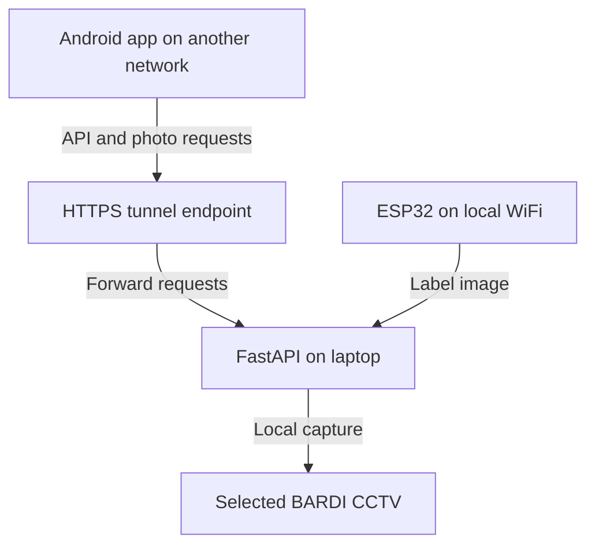
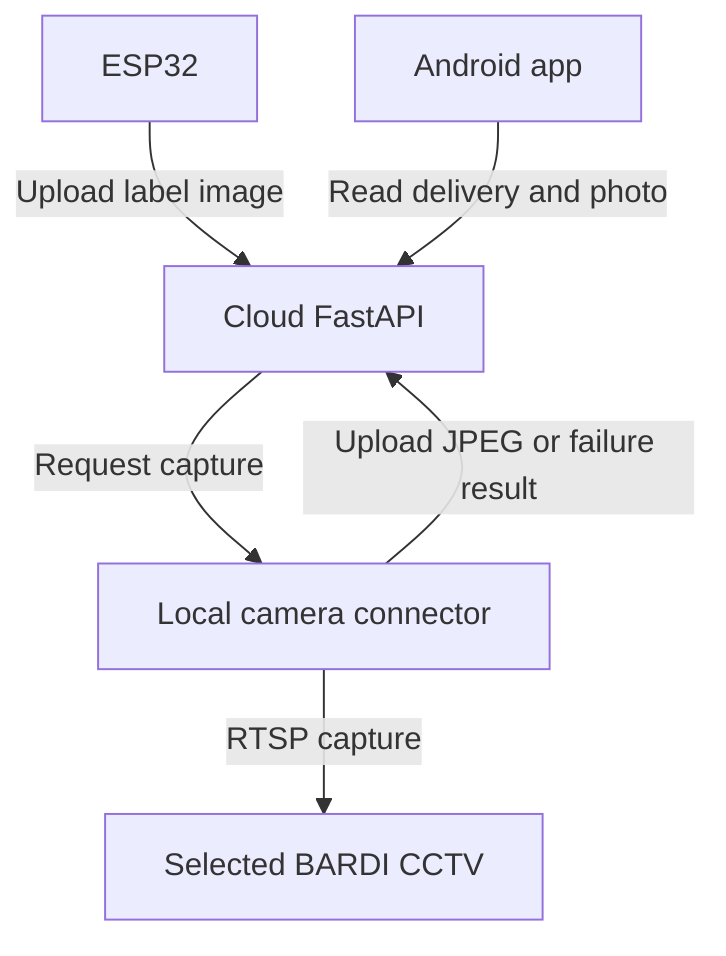

# Backend Deployment Discussion

> Imported from [Notion](https://app.notion.com/p/4193556fda9281cbb170e423480a8f5d) on 2026-11-16. Source last edited: 2026-11-15T06:20:44.460Z.
>
> This is a planning snapshot. Decision labels and historical statements are preserved from the source. See the [repository README](../README.md) and engineering documentation for current implementation status.

**Status:** Discussion draft. No deployment change is approved by this document.

**Prepared:** 2026-11-15

**Demo deadline:** 2026-11-28

**Parent requirements:** [Smart Package Delivery Checker](prd.md)

> Decision to make
>
> Where should the Python backend run for the hackathon, and how will it reach the local BARDI camera and serve delivery details to Android phones?
>
> The current PRD baseline is a laptop on the devices' WiFi. Cloud hosting is being evaluated as an alternative. Tunnel use and provider remain undecided.

## 1. What is already agreed

| Area              | Confirmed position                                                                                               |
| ----------------- | ---------------------------------------------------------------------------------------------------------------- |
| Team              | Project initiator owns PM, frontend, and CCTV setup. Teammate owns backend and ESP32                             |
| Availability      | Weekday nights and full weekends, with Codex assisted coding                                                     |
| Mobile app        | Vue, Vite, and Capacitor. Android is the MVP. iOS is a future extension                                          |
| Backend           | Python with FastAPI direction and PostgreSQL preference. Prisma's intended role still needs clarification        |
| Scanner           | ESP32 camera and proximity sensor. Python backend decodes barcode images                                         |
| Courier feedback  | Light and buzzer signal successful decoding, without waiting for CCTV, tracking lookup, or push completion       |
| CCTV              | Multiple cameras can be registered. Admin designates one for delivery capture                                    |
| Delivery access   | Admin and members receive push alerts. Tapping opens the relevant delivery screen with photo and package details |
| Failure behaviour | Notify even if CCTV or tracking fails. Show Photo unavailable and/or Tracking details unavailable                |
| Setup             | Admin supplies WiFi credentials and backend address in firmware before flashing                                  |

**Unverified dependencies:** BARDI firmware 5.7.4 has an ONVIF menu and shows an IP address, but actual discovery, authentication, RTSP playback, and JPEG capture have not been tested. BinderByte access and live SPX tracking are unverified. Hardware budget is deferred. No repository, deployment, or provider account has been inspected or configured for this document.

## 2. The constraint that drives this decision

**Moving FastAPI to the cloud does not automatically make the household CCTV reachable.** If the camera only exposes RTSP on the private home network, a hosted server needs an additional connection path to reach it.

A cloud design therefore needs a local camera connector or an explicitly configured private network route. A connector could run on a laptop initially. A separate always available gateway would be a later hardware and operating decision.

Push delivery and app data access are different paths. A local backend can send requests to an internet push service, but a phone on mobile data also needs a reachable API and photo endpoint after the notification is tapped. [Firebase's architecture](https://firebase.google.com/docs/cloud-messaging/fcm-architecture) documents the server, messaging service, and receiving app roles. Firebase is an example here, not a newly selected provider.

## 3. Options at a glance

The following comparisons are project specific engineering assessments, not measured performance results.

| Question                                                      | A. Laptop with local access                                   | B. Laptop with HTTPS tunnel                                  | C. Cloud backend with local camera connector                                                     |
| ------------------------------------------------------------- | ------------------------------------------------------------- | ------------------------------------------------------------ | ------------------------------------------------------------------------------------------------ |
| Where does FastAPI run?                                       | Laptop                                                        | Laptop                                                       | Hosted service                                                                                   |
| Where is barcode decoding?                                    | Laptop Python backend                                         | Laptop Python backend                                        | Cloud Python backend                                                                             |
| How does ESP32 upload a label?                                | Local WiFi to laptop                                          | Local WiFi to laptop                                         | Internet HTTPS to cloud                                                                          |
| How does BARDI capture work?                                  | Laptop accesses local camera                                  | Laptop accesses local camera                                 | Local connector accesses camera and uploads JPEG                                                 |
| Can phones receive push on another network?                   | Yes, with working internet and push setup                     | Yes                                                          | Yes                                                                                              |
| Can phones open delivery details on another network?          | No, unless another access route is added                      | Yes, through the tunnel                                      | Yes, through the hosted API                                                                      |
| Must a laptop or local machine remain available?              | Yes, for the backend and camera                               | Yes, for backend, camera, and tunnel                         | A local machine is still needed for camera capture                                               |
| If the local machine stops                                    | Scanning and API access stop                                  | Scanning and tunnel API access stop                          | Cloud scanning and API can continue if ESP32 has internet. New camera photos fail                |
| Can stored details remain accessible while the laptop is off? | Not with laptop only storage and API                          | Not through a stopped laptop backend                         | Yes if API, database, and durable photo storage are hosted and available                         |
| Setup work                                                    | Local runtime, database, camera tools, and stable LAN address | Option A plus tunnel and public API access configuration     | Cloud runtime, database, durable images, local connector, and authenticated capture coordination |
| Main demo dependency                                          | LAN connectivity and laptop uptime                            | LAN, laptop, internet, and tunnel uptime                     | Internet, hosted services, and connector for photos                                              |
| Main cost categories                                          | Existing laptop, electricity, API usage                       | Option A plus any tunnel plan requirements                   | App runtime, database, storage, transfer, and API usage                                          |
| Best fit                                                      | A demonstration where phones can use the same WiFi            | A remote phone demonstration with most processing kept local | Continued use beyond the demo, if connector work fits the schedule                               |

No cost total or free tier assumption is approved. Compare current plans and expected usage before choosing a provider.

## 4. Option A: laptop with local app access

Run FastAPI and barcode decoding on a laptop connected to the ESP32 and CCTV network. PostgreSQL and image placement are separate choices. For the smallest demonstration setup, local storage is an option to evaluate.

The ESP32 uploads a label image locally, receives the decode result, and signals scan success. The backend attempts a camera snapshot and tracking lookup and sends the household alert. The Android app retrieves delivery data and photos through the laptop's LAN address.

**Tradeoff:** This keeps the camera path simple, but recipient phones must be able to reach the laptop. Receiving the push on mobile data alone does not satisfy the tap to delivery page requirement.

**Failure characteristics:** Loss of internet can leave local image decoding possible, while external tracking and push delivery fail. Whether to retain and resend alerts later is a separate reliability decision. If the laptop backend stops, scan success cannot be acknowledged because decoding is on the backend.

## 5. Option B: laptop with public HTTPS access through a tunnel

Keep Option A's local scan and camera paths. Add a tunnel agent to make selected HTTP API and image routes reachable through a public HTTPS address.

The arrows show application requests. The tunnel transport itself is established outbound by the laptop agent, allowing requests back over that connection. [ngrok](https://ngrok.com/docs/gateway/agent) and [Cloudflare Tunnel](https://developers.cloudflare.com/tunnel/) document this model.

**Authentication:** HTTPS encrypts transport. Our application must still authenticate users and check household access on delivery and photo requests. The tunnel URL is not an authentication credential. Keep tunnel agent credentials on the laptop.

**Tradeoff:** This can demonstrate phones using mobile data without introducing a separate camera connector service. It retains dependence on the laptop, backend process, tunnel agent, and internet. Prefer a stable API hostname so the installed app does not need a new backend address after every restart. Tunnel provider and plan are undecided.

## 6. Option C: hosted backend with a local camera connector

Host FastAPI, Python barcode decoding, PostgreSQL, and durable photo storage in the cloud. Keep a small capture process on a machine sharing the BARDI camera's LAN.

The capture request is a logical operation. The cloud needs a real authenticated path to the connector. Candidates include a connector initiated persistent connection or a bounded polling mechanism. No command transport has been selected. Merely putting a private camera IP address into cloud configuration will not create that path.

The connector performs camera access and returns a JPEG or a capture failure. It does not move barcode decoding back onto ESP32. Retain the agreed Python backend decoding location in the cloud.

**Tradeoff:** App API and stored history can remain accessible without the local laptop backend running. However, fresh CCTV capture still depends on a local connector. Moving everything to the cloud while eliminating all local camera access infrastructure has not been shown feasible for this camera.

**Failure characteristics:** If the connector fails, the backend still handles a successful barcode scan and sends an alert with Photo unavailable. If internet access from ESP32 fails, cloud decoding and its success response are unavailable.

**Runtime choice to evaluate:** A hosted service or container is a useful candidate for FastAPI and any persistent capture coordination. Any function based alternative must first be checked against its execution, connection, dependency, and background processing limits. No runtime provider is selected.

## 7. Data and deployment decisions to keep explicit

| Topic               | Laptop options                                                                                  | Cloud option                                                                                                                            |
| ------------------- | ----------------------------------------------------------------------------------------------- | --------------------------------------------------------------------------------------------------------------------------------------- |
| PostgreSQL          | Could be local or hosted. Backups and restart behaviour still need a plan                       | Hosted PostgreSQL is a candidate. Confirm access, persistence, and cost                                                                 |
| Photo storage       | Local directory can work while laptop is running. Authenticated API must serve images to phones | Use explicitly durable storage such as object storage or a suitable volume. Do not assume the application filesystem preserves uploads  |
| Native dependencies | Install the chosen decoder dependencies and camera tools locally                                | Ensure the deployed image contains the barcode decoder's required libraries. Camera FFmpeg would run on the local connector in Option C |
| Migrations          | Run an explicit migration step                                                                  | Configure an explicit deploy or release step. Git based deployment alone does not define migration behaviour                            |
| Monorepo            | Start the correct backend app and use its own configuration                                     | Configure backend root, build context, watch paths, and start command. Do not deploy the frontend or ESP32 app as the backend           |
| Secrets             | Separate configuration from distributed firmware templates and source                           | Use provider secret configuration and separate local connector credentials                                                              |
| Recovery            | Preserve database and photo directories when restarting processes                               | Verify database and photo persistence across redeploys and service restarts                                                             |

**Storage evidence:** [Render](https://render.com/docs/disks) documents that its default service filesystem is ephemeral. [Railway volumes](https://docs.railway.com/volumes/reference) provide explicitly persistent storage. This illustrates why storage must be selected rather than inferred from application hosting.

**Database tooling:** The teammate previously preferred Prisma alongside Python. The PRD records that Prisma Client Python is archived. Clarify whether Prisma means schema and migrations, runtime queries, or something else before defining deployment commands. No alternative ORM is selected here.

## 8. Cloud and tunnel candidates

| Candidate         | Documented capability relevant to this project                                                                                                                                                                                                                        | Check before selecting                                                                                           |
| ----------------- | --------------------------------------------------------------------------------------------------------------------------------------------------------------------------------------------------------------------------------------------------------------------- | ---------------------------------------------------------------------------------------------------------------- |
| Railway           | [FastAPI deployment](https://railway.com/guides/fastapi), [GitHub autodeploys](https://docs.railway.com/deployments/github-autodeploys), and explicit [predeploy commands](https://docs.railway.com/deployments/pre-deploy-command) for operations such as migrations | Runtime and database cost, image persistence, selected region, required dependencies, and monorepo configuration |
| Render            | [FastAPI web services](https://render.com/docs/web-services) and [Git based deploys](https://render.com/docs/deploys)                                                                                                                                                 | Plan behaviour, runtime and storage cost, persistent images, and background coordination needs                   |
| ngrok             | [Agent based access](https://ngrok.com/docs/gateway/agent) to a local HTTP service through an outbound connection                                                                                                                                                     | Stable hostname, account and plan constraints, app authentication, and venue access                              |
| Cloudflare Tunnel | [Public hostname routing](https://developers.cloudflare.com/tunnel/) through an outbound connector                                                                                                                                                                    | Hostname setup, account requirements, native API access, app authentication, and venue access                    |

Railway documents a configurable predeploy command for migrations, and Render documents a predeploy stage with plan restrictions. These features must be configured and tested with the chosen migration tool. None of these providers has been selected or tested for this project.

## 9. Recommendation for the discussion

**Suggested demonstration default: Option B, if remote phone access is part of the demo.** It retains the existing laptop baseline and the shortest local path to the camera while allowing phones on mobile data to open delivery details.

**Choose Option A** if same WiFi phone access is sufficient and reducing setup work matters most.

**Choose Option C** if an independently reachable cloud API is a strong objective and the teammate is comfortable implementing and operating the local camera connector within the remaining schedule.

These are engineering recommendations based on the agreed scope, not commitments. First validate camera access. Hosting cannot compensate for a camera that does not expose the required stream.

## 10. Questions to settle together

1. Must the demonstration show a phone on mobile data opening the photo and delivery details?
2. Is the goal a reliable November 28 demo, continued use after the hackathon, or both?
3. Can a local laptop or connector remain available whenever new CCTV photos are needed?
4. Which option can the teammate implement and test with the least new infrastructure?
5. What total recurring spend is acceptable for runtime, database, photos, transfer, and tunnel access?
6. Where will PostgreSQL and JPEGs live, and will they survive restart and redeployment?
7. If choosing cloud, what is the capture request and photo upload path between cloud and the local connector?
8. What is the agreed migration tool and deployment command?

## 11. Evidence needed before calling deployment ready

These are proposed validation checks, not completed tasks or assigned dates.

- [ ] Decode a label captured by the actual ESP32 and return scan success without waiting for camera or tracking completion.
- [ ] Capture a real JPEG from the BARDI camera through the chosen local process.
- [ ] Open a delivery and its protected photo from the Android app on the agreed network.
- [ ] Receive a push and open the matching delivery, with the app in the background.
- [ ] Demonstrate the existing camera and tracking failure states.
- [ ] Restart or redeploy the backend and verify that records and photos persist as intended.
- [ ] Confirm that one household cannot retrieve another household's delivery or photo.
- [ ] For Option B, confirm tunnel restart and hostname behaviour.
- [ ] For Option C, stop the connector and confirm that cloud scanning and notifications continue with Photo unavailable.
- [ ] Record the chosen option and any remaining limitations in the PRD.

## 12. Decision record to complete after discussion

| Item                              | Outcome                                                          |
| --------------------------------- | ---------------------------------------------------------------- |
| Selected option                   | Undecided                                                        |
| Cloud or tunnel provider          | Undecided                                                        |
| PostgreSQL location               | Undecided                                                        |
| Photo storage                     | Undecided                                                        |
| Remote phone access required      | Undecided                                                        |
| Camera access mechanism           | Unverified                                                       |
| Backend deployment implementation | Teammate owns backend. Specific deployment work not yet assigned |
| CCTV setup and validation         | Project initiator                                                |
| Budget approval                   | Pending discussion                                               |
| Effect on current PRD             | Keep the laptop baseline unless the team explicitly changes it   |
| Reason for choice                 | To be recorded                                                   |
